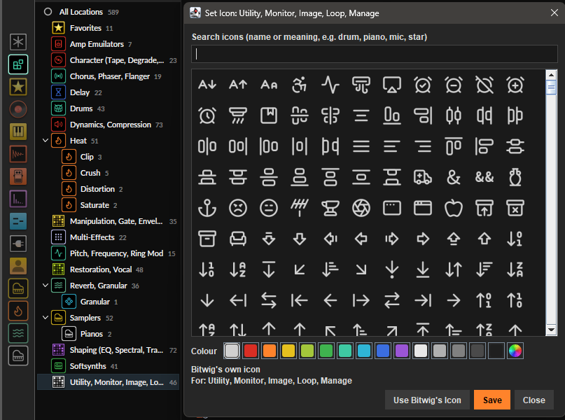
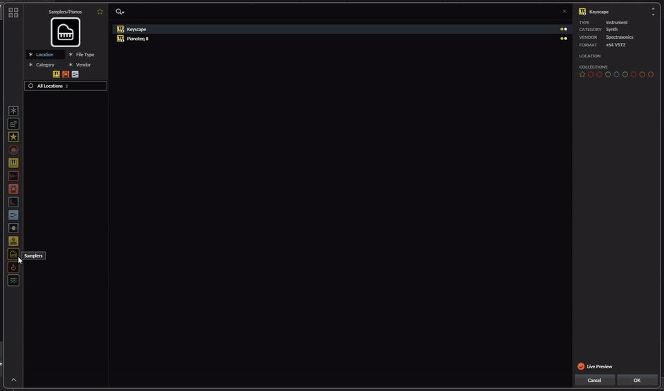
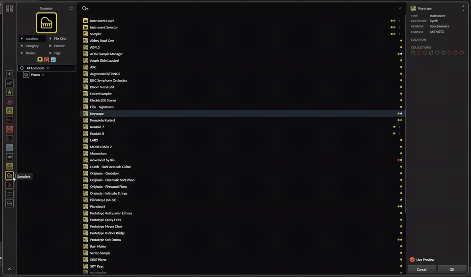

# Browser: Collections and Icons

Part of **NocTweaks** by noctaur.

## What it adds

- **Folders for collections.** Name a collection `Drums/Kits` and it sits in a `Drums` folder; folders can
  hold folders. A collection can also hold collections, and then shows everything its children hold.
  Rename, move and create from the browser's right-click menu.

  

- A **Collections** button in the browser sidebar that shows only your collections and their folders. Hide it
  or bring it back from right-click › *Sidebar Buttons*.
- **Pin to Quick Sources:** right-click a collection › *Pin to Quick Sources* puts it on the sidebar as its own
  button, in the main browser and the popups (past Bitwig's limit of 12). Its Location column shows just that collection and the collections
  inside it, expanded.

  

- **Location first:** picking a sidebar button opens the Location column, so the folders are right there.

  

- **Your own icons:** right-click a collection or folder › *Set Icon…* opens a picker with every
  [Lucide](https://lucide.dev/icons) icon (search by name or tag), in one of Bitwig's colours or any colour from the colour wheel. The sidebar buttons
  get theirs from *Sidebar Buttons* (including the Tracks button, if [Track Presets](../noctweaks-track-presets) is installed).

  

- **Each plugin once** in the browser, instead of once per format (VST3, VST2, CLAP); the preferred format is
  the one used.

Track presets, which used to be part of this mod, are now their own mod: [Track Presets](../noctweaks-track-presets).

## Icons

The picker writes `icons.txt` in the `.suite` folder inside Bitwig's collections folder
(`%LOCALAPPDATA%\Bitwig Studio\library\collections\7\` on Windows), which you can also
edit by hand, one line per collection or folder: `Drums/Kits = drum orange` (Lucide icon name, then an optional
colour: red, orange, yellow, lime, green, mint, turquoise, blue, purple, white, black, light_grey, grey,
dark_grey, or a custom `#rrggbb`). Folders end with `/` (`Drums/ = folder blue`); `@sidebar` is the Collections button and `@tracks` the Tracks button.

## Notes

- Built against Bitwig 6.1.4, Patchbay's reference version, so Patchbay can run it on every Bitwig version it
  supports (6.0 to 6.1.7) on Windows, macOS and Linux. So far it has only been tested on Windows with 6.1.7.
- Your collections, folders and icons are the same files NocTweaks and the Enhancement Suite used, so
  nothing needs moving.
- Lucide icons: ISC licence (`icons/LUCIDE-LICENSE.txt`).
- Not affiliated with Bitwig: an unofficial community project, not made, endorsed or supported by Bitwig GmbH.
