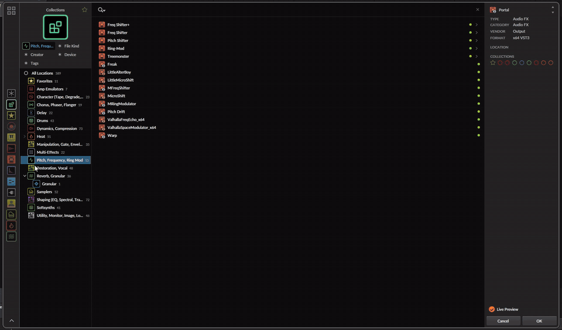
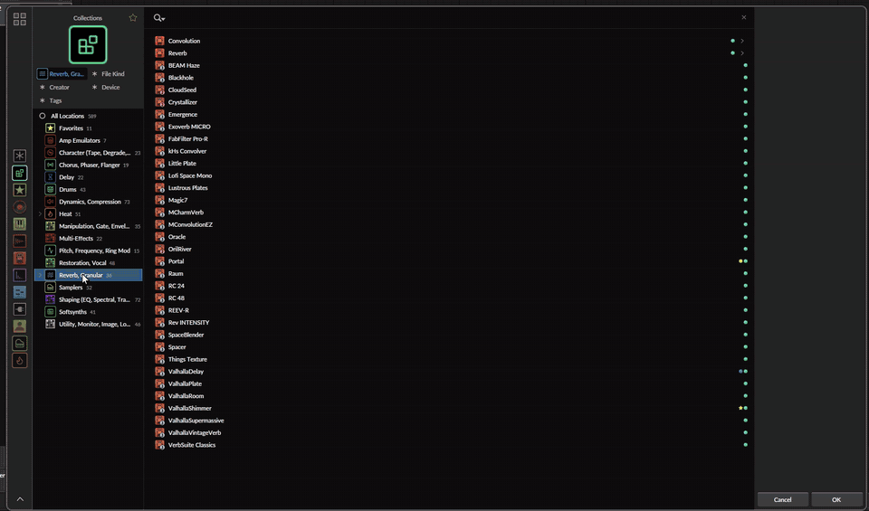
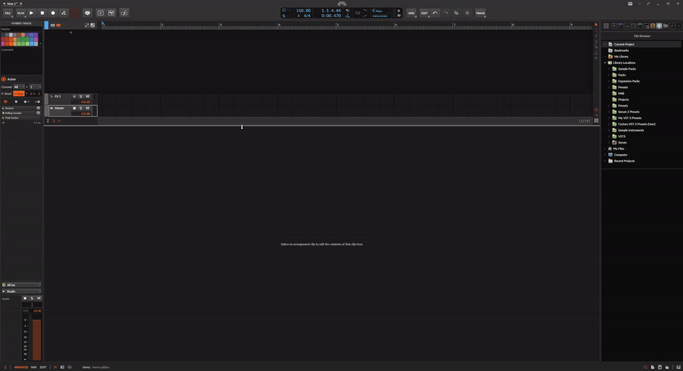
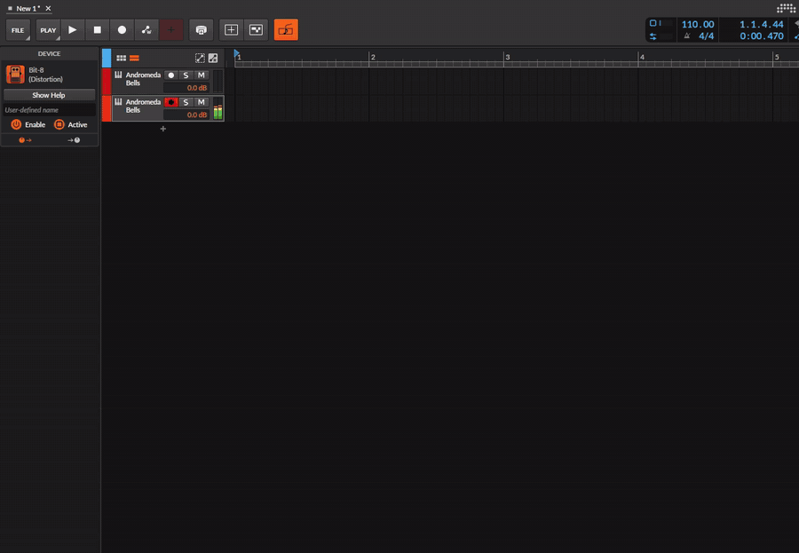
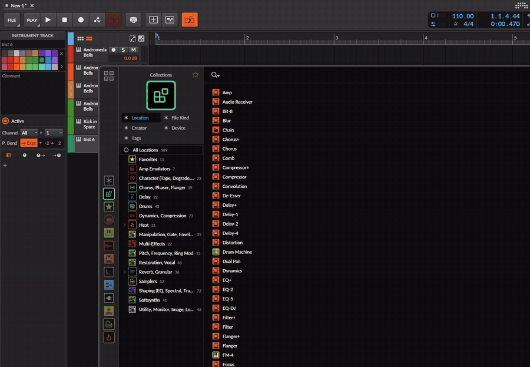

# Browser: Collections, Icons and Track Presets

Part of **NocTweaks** by noctaur.

## What it adds

- **Folders for collections.** Name a collection `Drums/Kits` and it sits in a `Drums` folder; folders can
  hold folders. A collection can also hold collections, and then shows everything its children hold.
  Rename, move and create from the browser's right-click menu.

  

- **Collections** and **Tracks** buttons in the browser sidebar. Collections shows only your collections and
  their folders. Tracks lists your track presets (main browser only, not the device popups). Hide or bring
  either back from right-click › *Sidebar Buttons*.
- **Pin to Quick Sources:** right-click a collection › *Pin to Quick Sources* puts it on the sidebar as its own
  button, in the main browser and the popups (past Bitwig's limit of 12). Its Location column shows just that collection and the collections
  inside it, expanded.

  

- **Location first:** picking a sidebar button opens the Location column, so the folders are right there.

  

- **Your own icons:** right-click a collection or folder › *Set Icon…* opens a picker with every
  [Lucide](https://lucide.dev/icons) icon (search by name or tag), in one of Bitwig's colours or any colour from the colour wheel. The sidebar buttons
  get theirs from *Sidebar Buttons*.

  

- **Each plugin once** in the browser, instead of once per format (VST3, VST2, CLAP); the preferred format is
  the one used.
- **Track presets (experimental):** *Save Track as Track Preset* and *Add Track Preset Below…* in the track
  header menu, *Add Track Preset* in the arranger and panel background menus, and the Tracks button to browse
  them. Dropping a one-track preset adds that track, not a group.

  

  

  

## Icons

The picker writes `%LOCALAPPDATA%\Bitwig Studio\library\collections\7\.suite\icons.txt`, which you can also
edit by hand, one line per collection or folder: `Drums/Kits = drum orange` (Lucide icon name, then an optional
colour: red, orange, yellow, lime, green, mint, turquoise, blue, purple, white, black, light_grey, grey,
dark_grey, or a custom `#rrggbb`). Folders end with `/` (`Drums/ = folder blue`); `@sidebar` and `@tracks` are the two buttons.

## Notes

- Bitwig 6.1.7 (Windows) only for now.
- Your collections, folders and icons are the same files NocTweaks and the Enhancement Suite used, so
  nothing needs moving.
- Lucide icons: ISC licence (`icons/LUCIDE-LICENSE.txt`).
- Not affiliated with Bitwig: an unofficial community project, not made, endorsed or supported by Bitwig GmbH.
