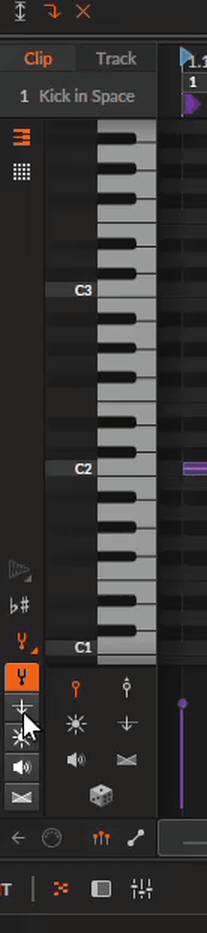

# Editor: Edit Modes Strip

Part of **NocTweaks** by noctaur.

Bitwig 6 hides the editor's edit modes behind a hold-to-open button in the editor's bottom-left corner: the
note expressions in the piano roll, and Stretch, Gain, Pan, Transpose, Formant and Onsets in the audio
editor. This mod adds a strip of buttons for them beside that button, so each mode is one click away. The
original button still works, and the strip always shows the mode that's selected.

## Notes

- The strip uses Bitwig's own segmented buttons, bound to the same setting as the original button.
- Built against Bitwig 6.1.4, Patchbay's reference version, so Patchbay can run it on every Bitwig version it
  supports (6.0 to 6.1.7) on Windows, macOS and Linux. So far it has only been tested on Windows with 6.1.7.
- Not affiliated with Bitwig: an unofficial community project, not made, endorsed or supported by Bitwig GmbH.
