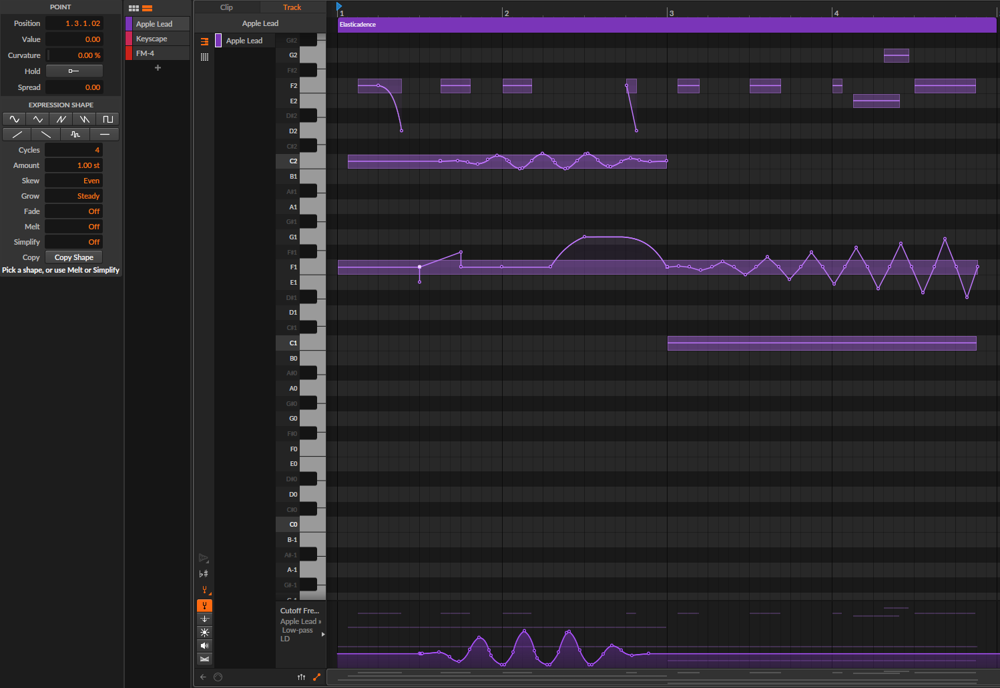
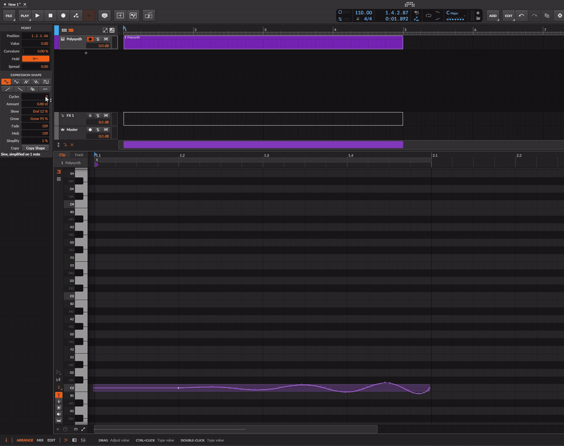
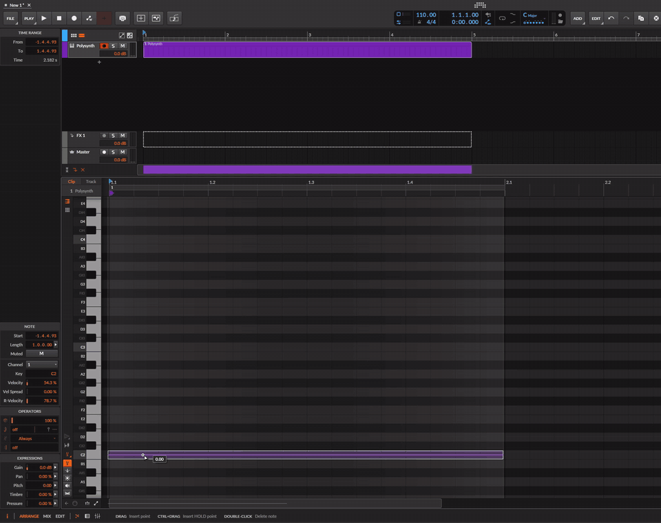
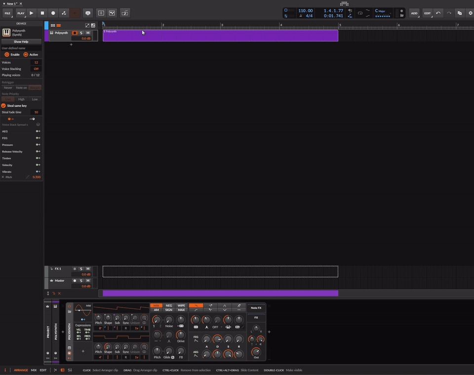
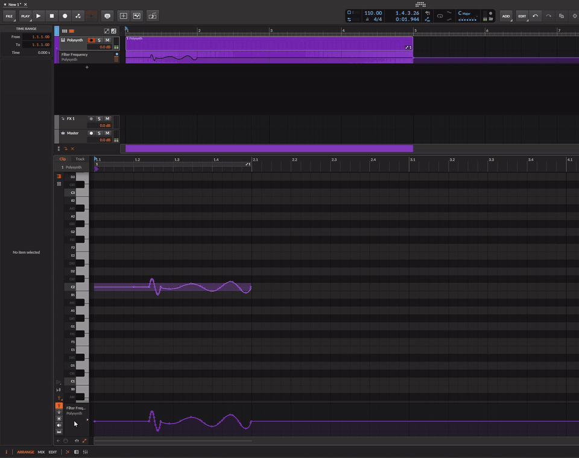

# Piano Roll: Expression Controls

Part of **NocTweaks** by noctaur. Note expression tools for the piano roll.

## How to use it: it all works on nodes

Almost everything here works on **expression nodes** (the points on a note's expression curve), not on notes.
Selecting a note isn't enough; the tools only show up once nodes are selected.

1. Open a note's expression (Pitch/Transpose, Pressure, Timbre, Gain or Pan) in the piano roll.
2. **Select nodes:** click one node, or drag a box around several.
3. The **Points Inspector** then shows the *Expression Shape* section, and right-clicking a selected node shows
   the shape and copy items.

What gets changed depends on the nodes you select:

- **Several nodes:** the stretch from the first selected node to the last.
- **One node:** from that node to the next node (or to the end of the note if it's the last).

To paste a copied shape onto automation, the same applies: select an **automation node** first, and the shape
starts there.

## What it adds

- **Expression Shape** section in the Points Inspector (with nodes selected): pick a shape
  (sine, triangle, saw up/down, square, ramps, random, flat) and draw it over the selected expression
  points, with Cycles, Amount, Skew, Grow/Fade, In/Out, live **Melt** and **Simplify**: redraws the selection with
  far fewer points that keep its shape, the way you'd draw it by hand with Alt-curved segments (a point on
  each peak and trough and one between them, each segment bent to fit). Higher amounts let go of small wiggles. Every change is one undo step.

  

  

- **Copy an expression shape onto automation:** select expression points and click *Copy Shape* in the
  Inspector (or right-click › *Copy Expression Shape*). Then select an automation point: its Points Inspector
  has a *Paste Expression Shape* section with a **Depth** (*As Copied*, or how far the shape swings, as a
  share of the target's range, in 5 % steps) and a *Paste Shape* button; its right-click menu has the same at
  fixed depths. The shape starts at that point's time and level, curved segments included.

  

- Shape items in the note editor's right-click menu and in the menu for selected notes and points.
- **Ctrl+drag copies expression points**, like notes: the originals stay put, a preview of the copy follows
  the mouse, and on release the copied shape is written where you drop it, smoothed into the points around it.
- The editor's **edit modes** as a strip of buttons beside the mode button, so each is one click away.

  

- The note editor opens on the **piano roll** instead of the drum grid on tracks with a drum machine
  (picking the drum grid by hand still works).

## Notes

- Bitwig 6.1.7 (Windows) only for now; on other versions Patchbay shows it as
  not available.
- The shape icons are the mod's own SVGs (in `icons/`).
- Not affiliated with Bitwig: an unofficial community project, not made, endorsed or supported by Bitwig GmbH.
