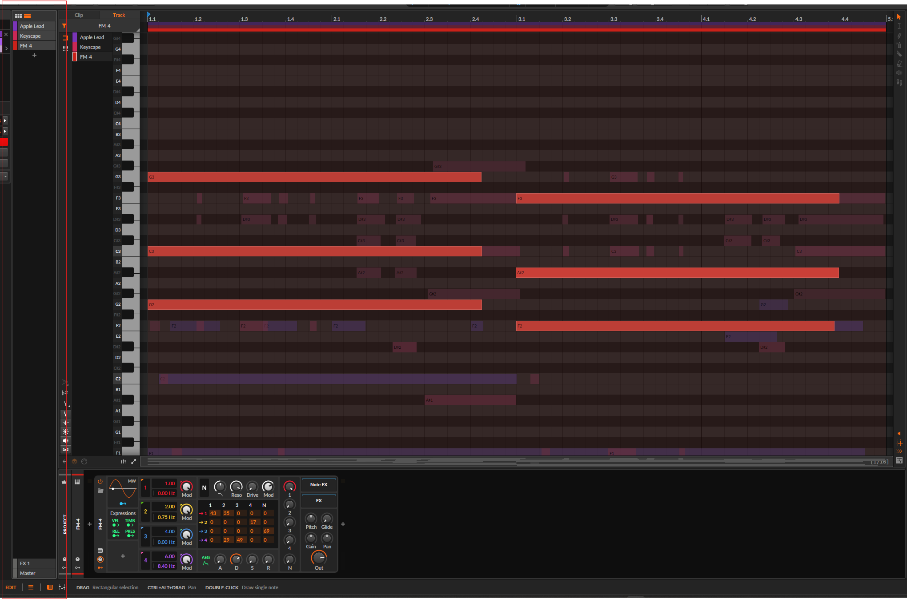
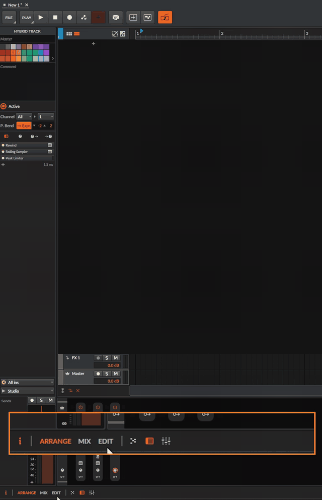
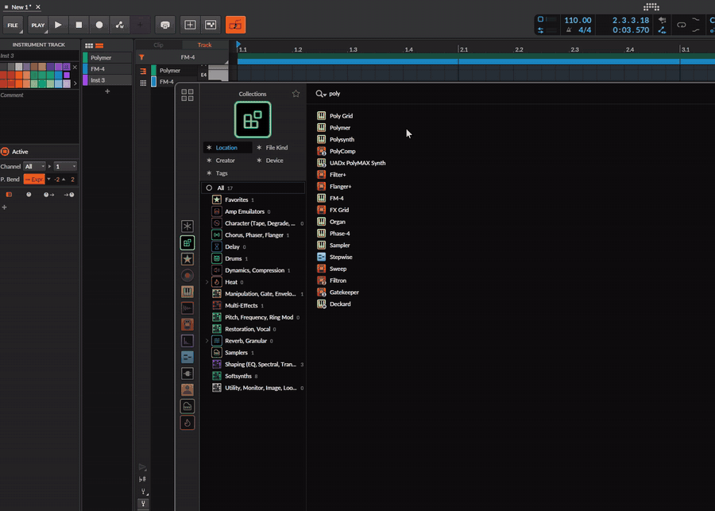

# Piano Roll: Global Track View

Part of **NocTweaks** by noctaur. Edit any track in the piano roll without going back to the arranger.

## What it adds

- **Edit Tracks** in the right-click menu of the editor's track list: every track in the project as a
  checkbox. Tick a track to add it to the tracks being edited (layered in the piano roll), untick it to take
  it out. **Edit All Tracks** edits every track at once. It uses the arranger's own track selection, so
  everything else in Bitwig behaves as usual.

  

- The editor's track list shows from **one** track up (Bitwig shows it from two), so the menu is always there.
- **Layered editing switches on** when the editor goes from one track to several. Turn it off yourself and it
  stays off until the next time you go from one track to several.

  

- The **Track List panel** beside the editor in the **Edit** screen, with its button in the footer (the panel
  from the Bitwig 6 beta). *Toggle Track List* works again.
- With **edit selected layers only** on, other tracks' note expressions are drawn as lines only: no points,
  and nothing of them can be hovered or grabbed.

## Notes

- Bitwig 6.1.7 (Windows) only for now; on other versions Patchbay shows it as
  not available.
- Not affiliated with Bitwig: an unofficial community project, not made, endorsed or supported by Bitwig GmbH.
