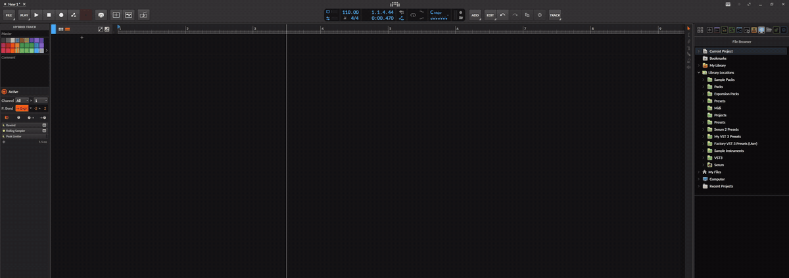
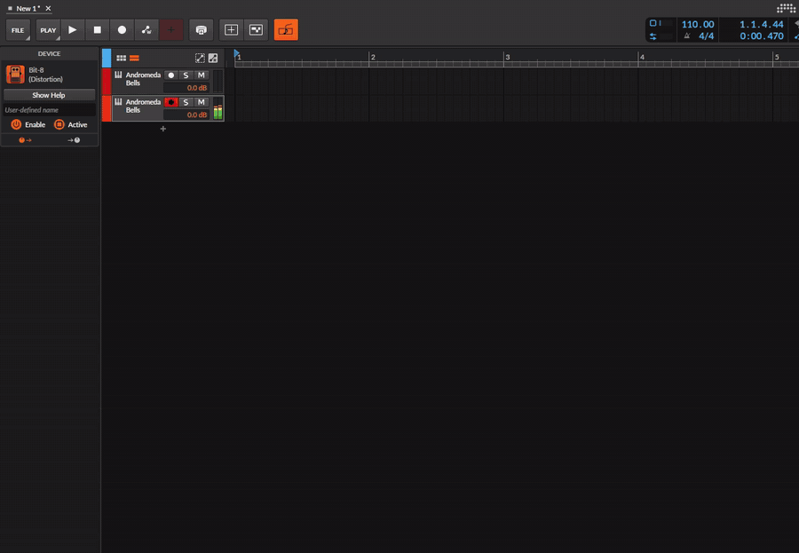

# Tracks: Track Presets

Part of **NocTweaks** by noctaur. Save whole tracks as presets and add them back into any project.
**Experimental.**

## What it adds

- A **Tracks** button in the browser sidebar (the main browser only, not the device popups) listing your track
  presets. Drag one onto the tracks: a preset with one track adds that track, not a group.

  

- **Save Track as Track Preset** in the track header's right-click menu: the track with its devices, plugin
  states, mixer settings, colour, name and clips.

  

- **Add Track Preset Below…** in the track header menu, and **Add Track Preset** in the arranger's and panels'
  background menus. Each has an **All** submenu with every preset, and a **Collections** submenu with each
  collection you've added presets to.

  

- **Hide Tracks Button** / **Show Tracks Button** in the browser's right-click menu.

## Notes

- Presets are saved in your Bitwig library, in `My Library/Track Presets/`, one `.bwproject` file each, so you
  can back them up, share them or sort them into folders.
- With [Browser: Collections and Icons](../noctweaks-browser-improvements) installed, the Tracks button's icon
  can be changed from the browser's *Sidebar Buttons* menu. Each mod works without the other.
- Built against Bitwig 6.1.4, Patchbay's reference version, so Patchbay can run it on every Bitwig version it
  supports (6.0 to 6.1.7) on Windows, macOS and Linux. So far it has only been tested on Windows with 6.1.7.
- Not affiliated with Bitwig: an unofficial community project, not made, endorsed or supported by Bitwig GmbH.
