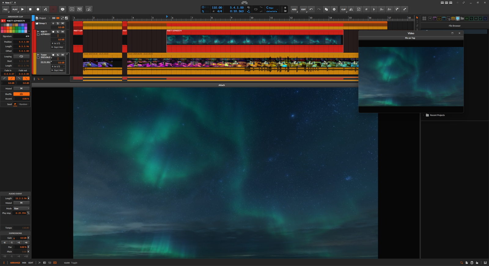
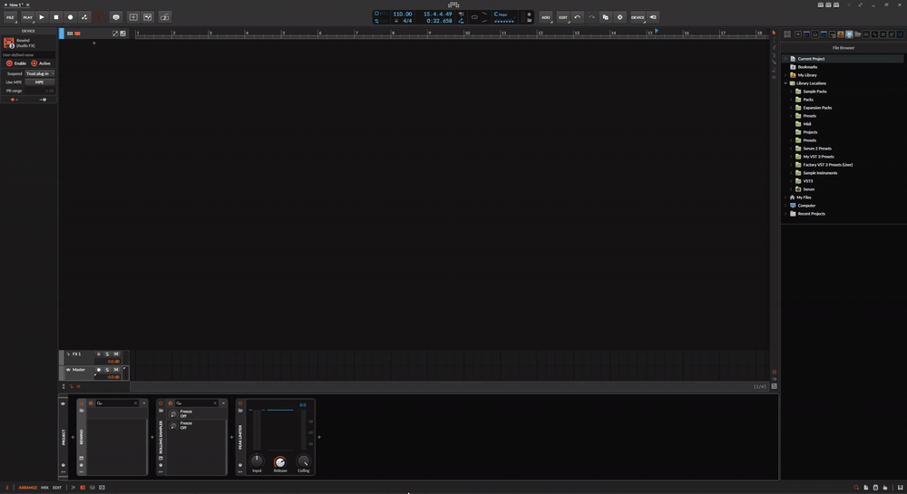
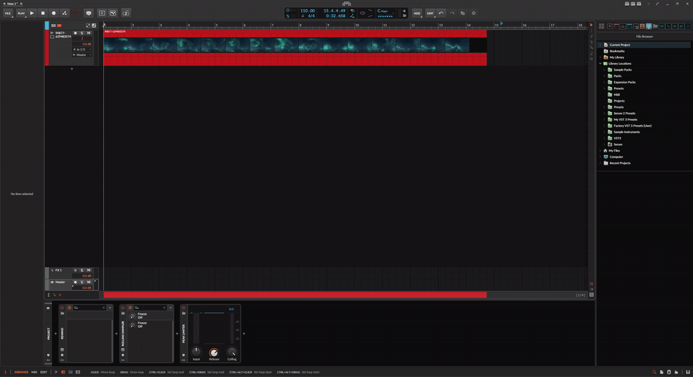
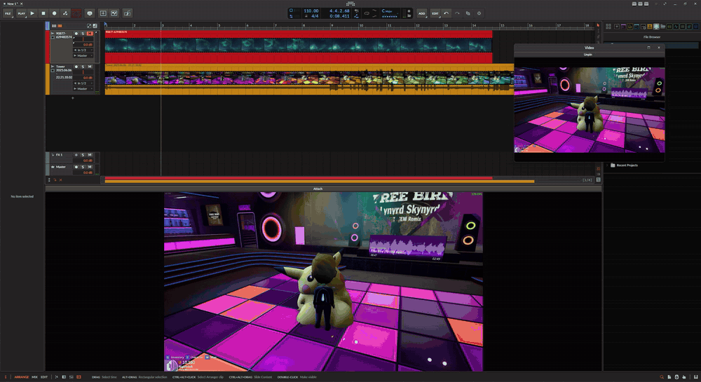
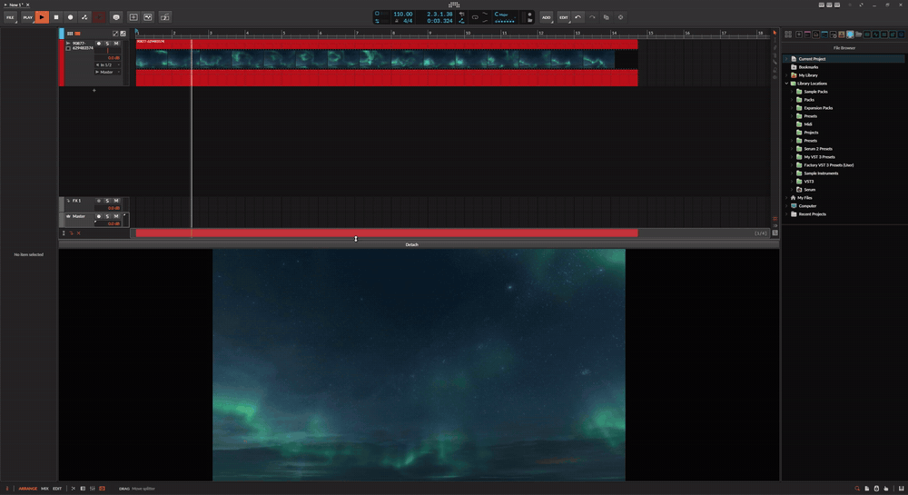
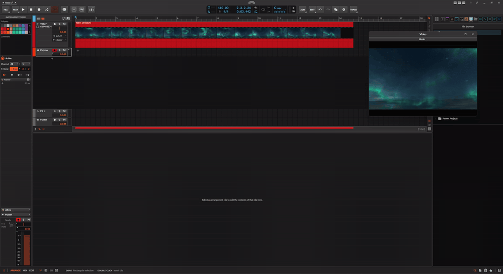
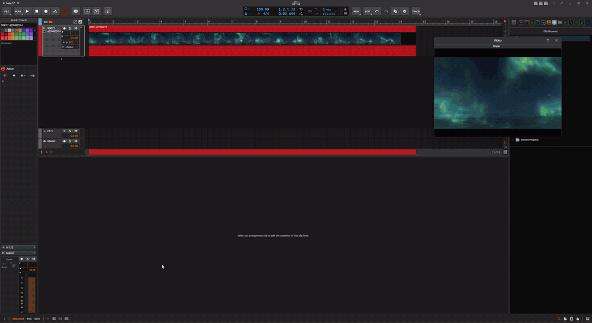
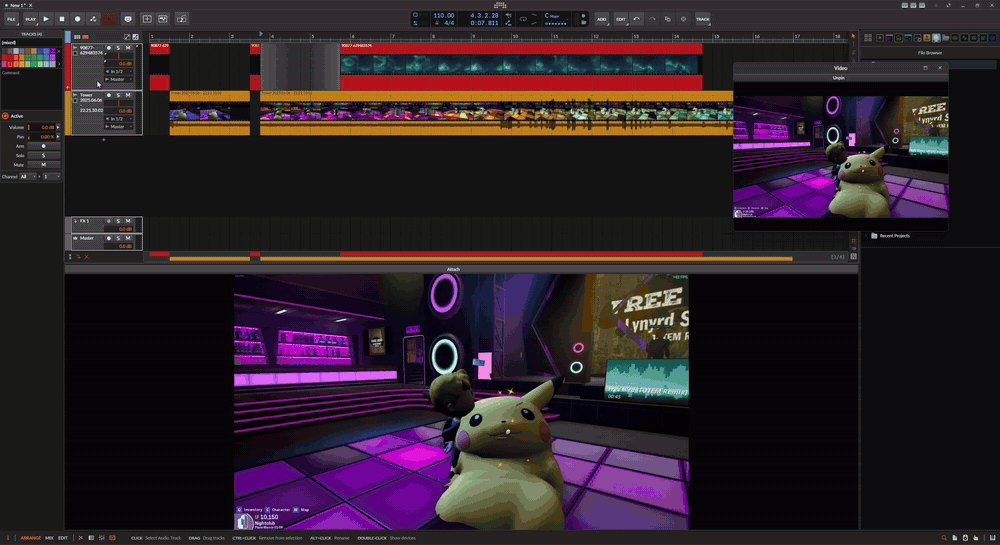

Video Track

Part of **NocTweaks** by noctaur.

**[Download the latest release](https://github.com/noctaur-dev/noctweaks/releases/tag/noctweaks-video-0.1.1)** (0.1.1), then add the zip in Patchbay with *Add Mod…*.
Pick the zip for your computer: `-windows`, `-macos-arm` (Apple silicon), `-macos-intel` or `-linux`. Each
comes in an **ffmpeg** and an **mpv** version (see [Which zip](#which-zip-ffmpeg-or-mpv)); Linux is ffmpeg only.

▶ [Watch the full showcase](https://github.com/noctaur-dev/noctweaks/blob/main/noctweaks-video/images/vid-showcase.mp4) (2½ minute video)

Video in Bitwig, the way video editors and other DAWs do it. Drop a video file on a track: its sound becomes
an audio clip that **is** the video, an AV track as I like to call it - and the picture plays in a **Video** panel that follows the clip wherever
it goes on the timeline.

## What it adds

- **Drop a video on a track.** Drag a video file (`.mp4`, `.mov`, `.m4v`, `.mkv`, `.webm`, `.avi`) from
  Explorer or Finder onto the arranger. Its sound goes in as an ordinary audio clip, and the clip gets a
  **film strip** across its top with pictures of the video, so it reads as video at a glance. A video with no
  sound gets a clip of silence as long as the video.

  

- **The Video panel.** Its button is in the bottom bar, next to Bitwig's own panel buttons. The picture follows
  Bitwig's transport: play, stop, scrub, jump and loop.

  

- **The clip is the video.** Move the clip, cut it, trim it or slip it, and the picture follows: each piece
  shows its own part of the video, and between clips the panel is black. Effects on the track only change the
  sound.

  

- **Detach the picture.** The panel's **Detach** button opens the picture in a window of its own, in Bitwig's
  style, as well as in the panel. Drag it anywhere (a second screen, beside the piano roll) and resize it. It's
  **pinned** by default, staying in front of Bitwig while you work in the editor or mixer; **Unpin** makes it
  an ordinary window and **Pin on Top** pins it again. **Attach** or the window's close button puts it away.

  

  

- **Several videos.** Drop as many as you like, on any tracks: each becomes an **AV track** (a small film icon
  under its track icon in the header) and all their sound plays. As in a video editor, the **highest AV track
  shows** in the panel; where it has a gap, the next one down shows through.

  

- **Mute to hide, groups count.** Muting an AV track hides its picture too, so the next one down shows. Tracks
  inside groups count in the order the arranger lists them, and muting a group mutes the videos in it.

  

## Where the sound copies go

Bitwig can't read sound straight out of a video file, so the mod makes a WAV of it (with ffmpeg or mpv) and that's what
the clip plays. By default the WAVs are kept out of the way in the mod's own data folder (`sounds/`, one
folder per video), not next to your videos. To change that, **Settings > Locations > Video > Sound copies of
videos**:

- **In the Video mod's folder** (default)
- **Next to each video** (as `<name> (sound).wav`)
- **In a folder you choose**: pick it with **Choose Folder for Sound Copies...** in the Video menu

A copy can be deleted once no project uses it; dropping the video again makes it again.

## The Video menu

Right-click a video clip, then **Video**:

- **Video: <name>** shows which video the clip is.
- **Forget This Video**: its clips become plain audio clips again.
- **Detach Video to a Window**: the same window as the panel's Detach button, without opening the panel.
- **Open Sound Copies Folder**, **Choose Folder for Sound Copies...**
- **Describe This Clip**: a diagnostic (what Bitwig holds for the clip), written to the log.

Right-click empty arranger space for **Detach Video to a Window** too, and **Forget All Videos**.

## Which zip: ffmpeg or mpv

The mod needs one free program to decode the pictures and make the WAVs: **ffmpeg** or **mpv**. Either one does
everything, and each zip comes with one of them, so there's nothing else to install.

- **ffmpeg zips** (`…-ffmpeg.zip`): Windows, macOS and **Linux**. ffmpeg is a single file, unpacked the first
  time the mod needs it. The smaller download.
- **mpv zips** (`…-mpv.zip`): Windows and macOS, for anyone who'd rather use mpv.

Both versions work the same: panel, film strips and the detached window. ffmpeg comes first and mpv is the
fallback: if you have both (one in the zip, the other installed), ffmpeg decodes the pictures and makes the
WAVs, unless **Settings > Locations > Video > Decode pictures with** says mpv. An mpv or ffmpeg already on your
computer (on the PATH, Homebrew, `/usr/bin`) is used too.

**Linux:** use the `-linux-ffmpeg` zip. mpv doesn't publish a Linux build, so there's no mpv zip for Linux; to
use your distribution's mpv instead, [`install-mpv.sh`](linux/install-mpv.sh) (also attached to the release)
installs it with your package manager: `sh install-mpv.sh`. Bitwig installed as a Flatpak isn't supported by Patchbay; use Bitwig's .deb or
.tar.gz.

The programs are unchanged builds: mpv 0.41.0, the official build from
[mpv's releases](https://github.com/mpv-player/mpv/releases/tag/v0.41.0) (GPL 2 or later), and ffmpeg 6.0, the
static builds packaged by [ffmpeg-static](https://github.com/eugeneware/ffmpeg-static) (GPL). Their licences are
in the zip's `tools` folder, and their source code is attached to the release (`mpv-0.41.0-source.tar.gz`,
`ffmpeg-6.0-source.tar.gz`). To build the zips, `sh fetch-ffmpeg.sh <platform>` or `sh fetch-mpv.sh <platform>`
puts the program in `package/tools` first.

## Needs

Patchbay's **Panels** framework (for the panel and its button) and **Settings** framework (for the sound copies
option), both part of Patchbay.

## Limits

- The videos are remembered after a restart, but they aren't tied to a project yet.
- The picture is decoded at up to 960 × 540 and scaled to the panel. Very large videos (4K HEVC or AV1) take more
  work to decode and may lag on slower computers.
- The preview steps through frames 30 times a second.

## Bitwig versions

Built against Bitwig 6.1.4, so Patchbay runs it on 6.0 to 6.1.7 on Windows, macOS and Linux. Tested on Bitwig
6.1.7 on Windows.

Not currently tested on macOS or Linux. In theory it should work: the Linux zip comes with ffmpeg, so nothing
else is needed, or you can install mpv from your package manager with [`install-mpv.sh`](linux/install-mpv.sh)
(see [Which zip](#which-zip-ffmpeg-or-mpv) above). The mod finds an installed mpv or ffmpeg in /usr/bin or
anywhere on the PATH.
